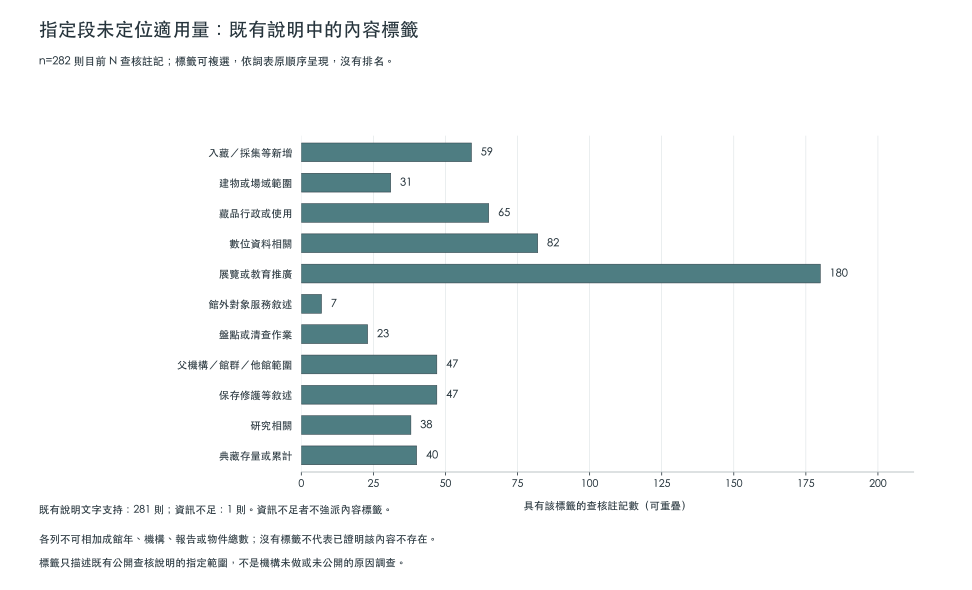

# 指定查核範圍的缺量內容註記

版本v0.16.0；275則目前N查核的說明註記。這不是機構未公開原因調查，也不是重新閱讀所有原件。

有文字支持274則，資訊不足1則。
275則來源查核、269個含N館年格與268個目前僅有N狀態的格是不同粒度；同館年有數值與另一來源指定段無量可並存。

## 判讀與證據

每列以review_id連回目前查核，保留來源、範圍、內容標籤、不可採原因及引文欄位。引文是整理者公開查核說明，不冒充官方PDF逐字引文；其中「本輪」依該查核日期解讀。v0.15.0新增11則指定子段補讀延伸，保留新日期與舊紀錄，不回填為舊版已讀；其餘註記沿用既有說明。
資訊不足不是零，也不會強塞其他類；未指派某標籤不代表已證明該內容不存在。數位作業、盤點或館外服務不是一律排除，須讀每筆原範圍。

標籤可複選，以下各列不可相加為館年、機構、報告或物件總數。

|內容標籤|查核註記數|
|---|---:|
|入藏／採集等新增|57|
|建物或場域範圍|30|
|藏品行政或使用|60|
|數位資料相關|80|
|展覽或教育推廣|177|
|館外對象服務敘述|7|
|盤點或清查作業|21|
|父機構／館群／他館範圍|47|
|保存修護等敘述|43|
|研究相關|36|
|典藏存量或累計|36|

## 不可採原因（僅限原查核指定範圍）

|原因標籤|查核註記數|
|---|---:|
|新增等不代既有藏品處理量|57|
|藏品行政／使用成果不代處理量|60|
|展覽／教育成果不代處理量|177|
|此則對象與目標範圍不同|5|
|此則盤點敘述未定位適用處理量|21|
|既有說明不足以判定具體原因|1|
|建物場域非本題動產範圍|30|
|存量不代處理量|36|
|此則其他數位成果未採為適用量|80|
|父機構／館群／他館範圍不拆配|47|
|提及保存修護但未定位適用量|43|
|研究成果不代處理量|36|

## 逐則註記索引

|館所|目標年|查核識別|內容標籤|判定|
|---|---:|---|---|---|
|國立傳統藝術中心|2020|batch5-main-BASE-009-2020|藏品行政或使用、數位資料相關|說明文字支持|
|國立傳統藝術中心|2021|batch5-main-BASE-009-2021|藏品行政或使用、數位資料相關|說明文字支持|
|國立傳統藝術中心|2022|batch5-main-BASE-009-2022|數位資料相關|說明文字支持|
|國立傳統藝術中心|2023|batch5-main-BASE-009-2023|數位資料相關|說明文字支持|
|國立傳統藝術中心|2024|batch5-main-BASE-009-2024|數位資料相關|說明文字支持|
|國立傳統藝術中心|2025|batch5-main-BASE-009-2025|數位資料相關|說明文字支持|
|臺南市立博物館（含鄭成功文物館、臺南左鎮化石園區）|2024|batch5-main-BASE-053-2024|展覽或教育推廣、研究相關|說明文字支持|
|臺南市立博物館（含鄭成功文物館、臺南左鎮化石園區）|2025|batch5-main-BASE-053-2025|展覽或教育推廣、研究相關|說明文字支持|
|高雄市電影館|2021|batch5-main-BASE-061-2021|數位資料相關、展覽或教育推廣|說明文字支持|
|高雄市電影館|2023|batch5-main-BASE-061-2023|數位資料相關、展覽或教育推廣|說明文字支持|
|高雄市電影館|2024|batch5-main-BASE-061-2024|數位資料相關、展覽或教育推廣、保存修護等敘述|說明文字支持|
|高雄市電影館|2025|batch5-main-BASE-061-2025|入藏／採集等新增、數位資料相關、展覽或教育推廣、盤點或清查作業|說明文字支持|
|澎湖生活博物館|2020|batch5-main-BASE-069-2020|入藏／採集等新增、父機構／館群／他館範圍、典藏存量或累計|說明文字支持|
|澎湖生活博物館|2021|batch5-main-BASE-069-2021|入藏／採集等新增、父機構／館群／他館範圍、典藏存量或累計|說明文字支持|
|澎湖生活博物館|2022|batch5-main-BASE-069-2022|入藏／採集等新增、父機構／館群／他館範圍、典藏存量或累計|說明文字支持|
|澎湖生活博物館|2023|batch5-main-BASE-069-2023|入藏／採集等新增、父機構／館群／他館範圍、典藏存量或累計|說明文字支持|
|澎湖生活博物館|2024|batch5-main-BASE-069-2024|入藏／採集等新增、父機構／館群／他館範圍、典藏存量或累計|說明文字支持|
|澎湖生活博物館|2025|batch5-main-BASE-069-2025|入藏／採集等新增、父機構／館群／他館範圍、典藏存量或累計|說明文字支持|
|澎湖海洋資源館|2020|batch5-main-BASE-070-2020|展覽或教育推廣、典藏存量或累計|說明文字支持|
|澎湖海洋資源館|2021|batch5-main-BASE-070-2021|展覽或教育推廣、典藏存量或累計|說明文字支持|
|澎湖海洋資源館|2022|batch5-main-BASE-070-2022|展覽或教育推廣、典藏存量或累計|說明文字支持|
|澎湖海洋資源館|2023|batch5-main-BASE-070-2023|展覽或教育推廣、典藏存量或累計|說明文字支持|
|澎湖海洋資源館|2024|batch5-main-BASE-070-2024|展覽或教育推廣、典藏存量或累計|說明文字支持|
|澎湖海洋資源館|2025|batch5-main-BASE-070-2025|展覽或教育推廣、典藏存量或累計|說明文字支持|
|馬祖民俗文物館|2020|batch5-main-SUP-012-2020|展覽或教育推廣|說明文字支持|
|馬祖民俗文物館|2021|batch5-main-SUP-012-2021|展覽或教育推廣|說明文字支持|
|馬祖民俗文物館|2022|batch5-main-SUP-012-2022|展覽或教育推廣|說明文字支持|
|馬祖民俗文物館|2023|batch5-main-SUP-012-2023|展覽或教育推廣|說明文字支持|
|中央研究院生物多樣性研究博物館－動物標本館|2023|batch6-biodiversity-ADD-012-2023|藏品行政或使用、數位資料相關、父機構／館群／他館範圍|說明文字支持|
|中央研究院生物多樣性研究博物館－動物標本館|2024|batch6-biodiversity-ADD-012-2024|藏品行政或使用、數位資料相關|說明文字支持|
|中央研究院生物多樣性研究博物館－動物標本館|2025|batch6-biodiversity-ADD-012-2025|數位資料相關、父機構／館群／他館範圍|說明文字支持|
|中央研究院生物多樣性研究博物館－植物標本館|2023|batch6-biodiversity-ADD-013-2023|藏品行政或使用、數位資料相關、父機構／館群／他館範圍|說明文字支持|
|行政院農業委員會特有生物研究保育中心|2020|batch6-biodiversity-BASE-028-2020|入藏／採集等新增、典藏存量或累計|說明文字支持|
|行政院農業委員會特有生物研究保育中心|2021|batch6-biodiversity-BASE-028-2021|入藏／採集等新增、典藏存量或累計|說明文字支持|
|行政院農業委員會特有生物研究保育中心|2022|batch6-biodiversity-BASE-028-2022|入藏／採集等新增、典藏存量或累計|說明文字支持|
|農業部生物多樣性研究所|2023|batch6-biodiversity-BASE-028-2023|入藏／採集等新增、典藏存量或累計|說明文字支持|
|農業部生物多樣性研究所|2024|batch6-biodiversity-BASE-028-2024|入藏／採集等新增、典藏存量或累計|說明文字支持|
|農業部生物多樣性研究所|2025|batch6-biodiversity-BASE-028-2025|研究相關、典藏存量或累計|說明文字支持|
|國立臺灣科學教育館|2020|batch6-main-BASE-012-2020|藏品行政或使用、數位資料相關、展覽或教育推廣、典藏存量或累計|說明文字支持|
|國立臺灣科學教育館|2021|batch6-main-BASE-012-2021|藏品行政或使用、數位資料相關、展覽或教育推廣、典藏存量或累計|說明文字支持|
|國立臺灣科學教育館|2022|batch6-main-BASE-012-2022|藏品行政或使用、數位資料相關、展覽或教育推廣、典藏存量或累計|說明文字支持|
|國立臺灣科學教育館|2023|batch6-main-BASE-012-2023|藏品行政或使用、數位資料相關、展覽或教育推廣、典藏存量或累計|說明文字支持|
|國立臺灣科學教育館|2024|batch6-main-BASE-012-2024|藏品行政或使用、數位資料相關、展覽或教育推廣、父機構／館群／他館範圍、典藏存量或累計|說明文字支持|
|國立臺灣科學教育館|2025|batch6-main-BASE-012-2025|藏品行政或使用、數位資料相關、展覽或教育推廣、典藏存量或累計|說明文字支持|
|國立自然科學博物館|2020|batch6-main-BASE-019-2020|入藏／採集等新增、數位資料相關、盤點或清查作業|說明文字支持|
|國立自然科學博物館|2021|batch6-main-BASE-019-2021|入藏／採集等新增、數位資料相關、盤點或清查作業|說明文字支持|
|國立自然科學博物館|2022|batch6-main-BASE-019-2022|入藏／採集等新增、數位資料相關、盤點或清查作業|說明文字支持|
|國立自然科學博物館|2023|batch6-main-BASE-019-2023|入藏／採集等新增、數位資料相關、盤點或清查作業|說明文字支持|
|國立自然科學博物館|2024|batch6-main-BASE-019-2024|入藏／採集等新增、數位資料相關、盤點或清查作業|說明文字支持|
|國立自然科學博物館|2025|batch6-main-BASE-019-2025|入藏／採集等新增、數位資料相關、盤點或清查作業|說明文字支持|
|臺北市立天文科學教育館|2020|batch6-main-BASE-032-2020|建物或場域範圍、展覽或教育推廣|說明文字支持|
|臺北市立天文科學教育館|2022|batch6-main-BASE-032-2022|建物或場域範圍、展覽或教育推廣|說明文字支持|
|臺北市立天文科學教育館|2023|batch6-main-BASE-032-2023|建物或場域範圍、展覽或教育推廣|說明文字支持|
|臺北市立天文科學教育館|2024|batch6-main-BASE-032-2024|建物或場域範圍、展覽或教育推廣|說明文字支持|
|臺北市立天文科學教育館|2025|batch6-main-BASE-032-2025|建物或場域範圍、展覽或教育推廣|說明文字支持|
|臺南市南瀛科學教育館|2023|batch6-main-BASE-054-2023|盤點或清查作業|說明文字支持|
|樹谷生活科學館|2024|batch6-main-BASE-056-2024|展覽或教育推廣、父機構／館群／他館範圍|說明文字支持|
|樹谷生活科學館|2025|batch6-main-BASE-056-2025|展覽或教育推廣、父機構／館群／他館範圍|說明文字支持|
|國立臺灣藝術大學有章藝術博物館|2025|body40-ntua-2025-new-official-body|藏品行政或使用、展覽或教育推廣|說明文字支持|
|國立臺灣藝術大學有章藝術博物館|2021|body40-ntua-new-original-BASE-017-2021-v1|入藏／採集等新增、藏品行政或使用、展覽或教育推廣|說明文字支持|
|花蓮縣考古博物館|2021|body40-root-BASE-067-2021|藏品行政或使用、展覽或教育推廣|說明文字支持|
|馬祖民俗文物館|2024|bodyfollowup-batch5-main-SUP-012-2024|展覽或教育推廣、保存修護等敘述、典藏存量或累計|說明文字支持|
|花蓮美術館|2020|br-east-south-add-003-2020|展覽或教育推廣|說明文字支持|
|花蓮美術館|2021|br-east-south-add-003-2021|展覽或教育推廣|說明文字支持|
|花蓮美術館|2022|br-east-south-add-003-2022|展覽或教育推廣|說明文字支持|
|花蓮美術館|2023|br-east-south-add-003-2023|展覽或教育推廣|說明文字支持|
|花蓮美術館|2024|br-east-south-add-003-2024|展覽或教育推廣|說明文字支持|
|花蓮美術館|2025|br-east-south-add-003-2025|展覽或教育推廣|說明文字支持|
|宜蘭美術館|2021|br-east-south-base-064-2021|保存修護等敘述、研究相關|說明文字支持|
|花蓮縣石雕博物館|2020|br-east-south-base-068-2020|展覽或教育推廣|說明文字支持|
|花蓮縣石雕博物館|2021|br-east-south-base-068-2021|展覽或教育推廣|說明文字支持|
|花蓮縣石雕博物館|2022|br-east-south-base-068-2022|展覽或教育推廣|說明文字支持|
|花蓮縣石雕博物館|2023|br-east-south-base-068-2023|展覽或教育推廣|說明文字支持|
|花蓮縣石雕博物館|2024|br-east-south-base-068-2024|展覽或教育推廣|說明文字支持|
|花蓮縣石雕博物館|2025|br-east-south-base-068-2025|展覽或教育推廣|說明文字支持|
|大園尖山考古館|2021|east-indigenous-ADD-007-2021|展覽或教育推廣、典藏存量或累計|說明文字支持|
|大園尖山考古館|2022|east-indigenous-ADD-007-2022|展覽或教育推廣、典藏存量或累計|說明文字支持|
|大園尖山考古館|2023|east-indigenous-ADD-007-2023|展覽或教育推廣、典藏存量或累計|說明文字支持|
|大園尖山考古館|2024|east-indigenous-ADD-007-2024|展覽或教育推廣、典藏存量或累計|說明文字支持|
|臺灣原住民族文化園區|2020|east-indigenous-BASE-025-2020|館外對象服務敘述、父機構／館群／他館範圍|說明文字支持|
|臺灣原住民族文化園區|2021|east-indigenous-BASE-025-2021|館外對象服務敘述、父機構／館群／他館範圍|說明文字支持|
|臺灣原住民族文化園區|2022|east-indigenous-BASE-025-2022|館外對象服務敘述、父機構／館群／他館範圍|說明文字支持|
|臺灣原住民族文化園區|2023|east-indigenous-BASE-025-2023|館外對象服務敘述、父機構／館群／他館範圍|說明文字支持|
|臺灣原住民族文化園區|2024|east-indigenous-BASE-025-2024|館外對象服務敘述、父機構／館群／他館範圍|說明文字支持|
|宜蘭縣史館（含宜蘭設治紀念館）|2020|east-indigenous-BASE-063-2020|入藏／採集等新增、藏品行政或使用、數位資料相關、展覽或教育推廣、盤點或清查作業|說明文字支持|
|宜蘭縣史館（含宜蘭設治紀念館）|2021|east-indigenous-BASE-063-2021|入藏／採集等新增、藏品行政或使用、數位資料相關、展覽或教育推廣|說明文字支持|
|宜蘭縣史館（含宜蘭設治紀念館）|2022|east-indigenous-BASE-063-2022|入藏／採集等新增、藏品行政或使用、數位資料相關、展覽或教育推廣、保存修護等敘述|說明文字支持|
|宜蘭縣史館（含宜蘭設治紀念館）|2023|east-indigenous-BASE-063-2023|入藏／採集等新增、藏品行政或使用、數位資料相關、展覽或教育推廣|說明文字支持|
|宜蘭縣史館（含宜蘭設治紀念館）|2024|east-indigenous-BASE-063-2024|入藏／採集等新增、藏品行政或使用、數位資料相關、展覽或教育推廣|說明文字支持|
|宜蘭縣史館（含宜蘭設治紀念館）|2025|east-indigenous-BASE-063-2025|入藏／採集等新增、藏品行政或使用、數位資料相關、展覽或教育推廣、保存修護等敘述|說明文字支持|
|臺灣戲劇館|2020|east-indigenous-BASE-065-2020|藏品行政或使用、數位資料相關、展覽或教育推廣|說明文字支持|
|臺灣戲劇館|2021|east-indigenous-BASE-065-2021|藏品行政或使用、數位資料相關、展覽或教育推廣|說明文字支持|
|臺灣戲劇館|2025|east-indigenous-BASE-065-2025|藏品行政或使用、數位資料相關、展覽或教育推廣|說明文字支持|
|花蓮縣考古博物館|2022|east-indigenous-BASE-067-2022|入藏／採集等新增、展覽或教育推廣、典藏存量或累計|說明文字支持|
|花蓮縣考古博物館|2023|east-indigenous-BASE-067-2023|入藏／採集等新增、展覽或教育推廣、典藏存量或累計|說明文字支持|
|花蓮縣考古博物館|2024|east-indigenous-BASE-067-2024|入藏／採集等新增、展覽或教育推廣、保存修護等敘述、典藏存量或累計|說明文字支持|
|花蓮縣考古博物館|2025|east-indigenous-BASE-067-2025|入藏／採集等新增、展覽或教育推廣、保存修護等敘述、典藏存量或累計|說明文字支持|
|新竹市玻璃工藝博物館|2021|optimization-hcc-local-body-BASE-045-2021-followup|展覽或教育推廣、父機構／館群／他館範圍|說明文字支持|
|新竹市玻璃工藝博物館|2022|optimization-hcc-local-body-BASE-045-2022-followup|展覽或教育推廣、父機構／館群／他館範圍|說明文字支持|
|新竹市玻璃工藝博物館|2023|optimization-hcc-local-body-BASE-045-2023-followup|展覽或教育推廣、父機構／館群／他館範圍|說明文字支持|
|新竹市玻璃工藝博物館|2024|optimization-hcc-local-body-BASE-045-2024-followup|展覽或教育推廣、父機構／館群／他館範圍|說明文字支持|
|新竹市美術館|2021|optimization-hcc-local-body-SUP-004-2021-followup|展覽或教育推廣、父機構／館群／他館範圍、保存修護等敘述|說明文字支持|
|新竹市美術館|2022|optimization-hcc-local-body-SUP-004-2022-followup|展覽或教育推廣、父機構／館群／他館範圍、保存修護等敘述|說明文字支持|
|新竹市美術館|2023|optimization-hcc-local-body-SUP-004-2023-followup|展覽或教育推廣、父機構／館群／他館範圍、保存修護等敘述|說明文字支持|
|新竹市美術館|2024|optimization-hcc-local-body-SUP-004-2024-followup|展覽或教育推廣、父機構／館群／他館範圍、保存修護等敘述|說明文字支持|
|梅嶺美術館|2025|optimization-meiling-SUP-008-2025-followup|藏品行政或使用、保存修護等敘述、研究相關|說明文字支持|
|基隆美術館|2024|review-ADD-002-2024-north-batch3|展覽或教育推廣|說明文字支持|
|基隆美術館|2025|review-ADD-002-2025-north-batch3|展覽或教育推廣|說明文字支持|
|苗栗陶瓷博物館|2020|review-ADD-004-2020-batch3-central|展覽或教育推廣|說明文字支持|
|苗栗陶瓷博物館|2022|review-ADD-004-2022-batch3-central|展覽或教育推廣、父機構／館群／他館範圍|說明文字支持|
|苗栗陶瓷博物館|2023|review-ADD-004-2023-batch3-central|展覽或教育推廣、父機構／館群／他館範圍|說明文字支持|
|苗栗陶瓷博物館|2024|review-ADD-004-2024-batch3-central|展覽或教育推廣|說明文字支持|
|南投縣政府文化局竹藝博物館|2020|review-ADD-006-2020-batch3-central|入藏／採集等新增、展覽或教育推廣|說明文字支持|
|南投縣政府文化局竹藝博物館|2021|review-ADD-006-2021-batch3-central|入藏／採集等新增、展覽或教育推廣|說明文字支持|
|南投縣政府文化局竹藝博物館|2022|review-ADD-006-2022-batch3-central|入藏／採集等新增、展覽或教育推廣|說明文字支持|
|南投縣政府文化局竹藝博物館|2023|review-ADD-006-2023-batch3-central|入藏／採集等新增、展覽或教育推廣|說明文字支持|
|南投縣政府文化局竹藝博物館|2024|review-ADD-006-2024-batch3-central|入藏／採集等新增、展覽或教育推廣|說明文字支持|
|國立臺北藝術大學關渡美術館|2020|review-BASE-013-2020-batch4-universities|藏品行政或使用、保存修護等敘述|說明文字支持|
|國立臺北藝術大學關渡美術館|2021|review-BASE-013-2021-batch4-universities|建物或場域範圍、保存修護等敘述|說明文字支持|
|國立臺北藝術大學關渡美術館|2022|review-BASE-013-2022-batch4-universities|數位資料相關、盤點或清查作業|說明文字支持|
|國立臺北藝術大學關渡美術館|2023|review-BASE-013-2023-batch4-universities|入藏／採集等新增、藏品行政或使用|說明文字支持|
|國立臺北藝術大學關渡美術館|2024|review-BASE-013-2024-batch4-universities|藏品行政或使用|說明文字支持|
|國立臺北藝術大學關渡美術館|2025|review-BASE-013-2025-batch4-universities|入藏／採集等新增、藏品行政或使用|說明文字支持|
|MoNTUE 北師美術館|2020|review-BASE-014-2020-batch4-universities|展覽或教育推廣|說明文字支持|
|MoNTUE 北師美術館|2021|review-BASE-014-2021-batch4-universities|展覽或教育推廣|說明文字支持|
|MoNTUE 北師美術館|2022|review-BASE-014-2022-batch4-universities|藏品行政或使用、館外對象服務敘述、保存修護等敘述|說明文字支持|
|MoNTUE 北師美術館|2023|review-BASE-014-2023-batch4-universities|保存修護等敘述|說明文字支持|
|MoNTUE 北師美術館|2024|review-BASE-014-2024-batch4-universities|展覽或教育推廣、研究相關|說明文字支持|
|MoNTUE 北師美術館|2025|review-BASE-014-2025-batch4-universities|展覽或教育推廣、館外對象服務敘述|說明文字支持|
|國立政治大學民族博物館|2022|review-BASE-015-2022-batch4-universities|數位資料相關、展覽或教育推廣|說明文字支持|
|國立政治大學民族博物館|2023|review-BASE-015-2023-batch4-universities|數位資料相關、展覽或教育推廣|說明文字支持|
|國立政治大學民族博物館|2024|review-BASE-015-2024-batch4-universities|藏品行政或使用、數位資料相關、展覽或教育推廣|說明文字支持|
|國立政治大學民族博物館|2025|review-BASE-015-2025-batch4-universities|展覽或教育推廣、保存修護等敘述|說明文字支持|
|國立自然科學博物館|2020|review-BASE-019-2020|盤點或清查作業|說明文字支持|
|國立自然科學博物館|2021|review-BASE-019-2021|盤點或清查作業|說明文字支持|
|國立自然科學博物館|2022|review-BASE-019-2022|盤點或清查作業|說明文字支持|
|國立自然科學博物館|2023|review-BASE-019-2023|盤點或清查作業|說明文字支持|
|國立自然科學博物館|2024|review-BASE-019-2024|盤點或清查作業|說明文字支持|
|國立自然科學博物館|2025|review-BASE-019-2025|盤點或清查作業|說明文字支持|
|國立海洋生物博物館|2020|review-BASE-022-2020-batch6-marine|入藏／採集等新增、展覽或教育推廣、典藏存量或累計|說明文字支持|
|國立海洋生物博物館|2021|review-BASE-022-2021-batch6-marine|入藏／採集等新增、數位資料相關、展覽或教育推廣|說明文字支持|
|國立海洋生物博物館|2022|review-BASE-022-2022-batch6-marine|入藏／採集等新增、數位資料相關、展覽或教育推廣|說明文字支持|
|國立海洋生物博物館|2023|review-BASE-022-2023-batch6-marine|入藏／採集等新增、數位資料相關、展覽或教育推廣|說明文字支持|
|國立海洋生物博物館|2024|review-BASE-022-2024-batch6-marine|保存修護等敘述|說明文字支持|
|國立海洋生物博物館|2025|review-BASE-022-2025-batch6-marine|入藏／採集等新增、數位資料相關、展覽或教育推廣|說明文字支持|
|臺北當代藝術館|2020|review-BASE-034-2020-north-batch3|數位資料相關、展覽或教育推廣|說明文字支持|
|臺北當代藝術館|2021|review-BASE-034-2021-north-batch3|數位資料相關、展覽或教育推廣|說明文字支持|
|臺北當代藝術館|2022|review-BASE-034-2022-north-batch3|數位資料相關、展覽或教育推廣|說明文字支持|
|臺北當代藝術館|2023|review-BASE-034-2023-north-batch3|數位資料相關、展覽或教育推廣|說明文字支持|
|臺北當代藝術館|2024|review-BASE-034-2024-north-batch3|數位資料相關、展覽或教育推廣|說明文字支持|
|臺北當代藝術館|2025|review-BASE-034-2025-north-batch3|數位資料相關、展覽或教育推廣|說明文字支持|
|臺北偶戲館|2020|review-BASE-035-2020-north-batch3|展覽或教育推廣|說明文字支持|
|臺北偶戲館|2021|review-BASE-035-2021-north-batch3|展覽或教育推廣|說明文字支持|
|臺北偶戲館|2022|review-BASE-035-2022-north-batch3|展覽或教育推廣|說明文字支持|
|臺北偶戲館|2023|review-BASE-035-2023-north-batch3|展覽或教育推廣|說明文字支持|
|臺北偶戲館|2024|review-BASE-035-2024-north-batch3|展覽或教育推廣|說明文字支持|
|臺北偶戲館|2025|review-BASE-035-2025-north-batch3|展覽或教育推廣|說明文字支持|
|新北市立十三行博物館|2020|review-BASE-036-2020-stage7|藏品行政或使用、典藏存量或累計|說明文字支持|
|新北市立鶯歌陶瓷博物館|2022|review-BASE-037-2022-stage6|藏品行政或使用、數位資料相關|說明文字支持|
|新北市立鶯歌陶瓷博物館|2023|review-BASE-037-2023-stage6|藏品行政或使用、數位資料相關|說明文字支持|
|新北市立鶯歌陶瓷博物館|2024|review-BASE-037-2024-stage6|藏品行政或使用、數位資料相關|說明文字支持|
|新北市立鶯歌陶瓷博物館|2025|review-BASE-037-2025-stage6|藏品行政或使用、數位資料相關|說明文字支持|
|新北市立淡水古蹟博物館|2020|review-BASE-038-2020-batch5-north-central|建物或場域範圍、展覽或教育推廣、研究相關|說明文字支持|
|新北市立淡水古蹟博物館|2021|review-BASE-038-2021-batch5-north-central|建物或場域範圍、展覽或教育推廣、研究相關|說明文字支持|
|新北市立淡水古蹟博物館|2022|review-BASE-038-2022-batch5-north-central|建物或場域範圍、展覽或教育推廣、研究相關|說明文字支持|
|新北市立淡水古蹟博物館|2023|review-BASE-038-2023-batch5-north-central|展覽或教育推廣、保存修護等敘述、研究相關|說明文字支持|
|新北市立淡水古蹟博物館|2024|review-BASE-038-2024-batch5-north-central|建物或場域範圍、展覽或教育推廣、研究相關|說明文字支持|
|新北市立淡水古蹟博物館|2025|review-BASE-038-2025-batch5-north-central|建物或場域範圍、展覽或教育推廣、研究相關|說明文字支持|
|烏來泰雅民族博物館|2020|review-BASE-040-2020-batch5-north-central|入藏／採集等新增、展覽或教育推廣、研究相關|說明文字支持|
|烏來泰雅民族博物館|2021|review-BASE-040-2021-batch5-north-central|入藏／採集等新增、展覽或教育推廣、研究相關|說明文字支持|
|烏來泰雅民族博物館|2022|review-BASE-040-2022-batch5-north-central|入藏／採集等新增、展覽或教育推廣、研究相關|說明文字支持|
|烏來泰雅民族博物館|2023|review-BASE-040-2023-batch5-north-central|入藏／採集等新增、展覽或教育推廣、研究相關|說明文字支持|
|烏來泰雅民族博物館|2025|review-BASE-040-2025-batch5-north-central|入藏／採集等新增、展覽或教育推廣、研究相關|說明文字支持|
|桃園市立大溪木藝生態博物館|2020|review-BASE-041-2020-stage7|建物或場域範圍、數位資料相關、盤點或清查作業、研究相關|說明文字支持|
|桃園市立大溪木藝生態博物館|2022|review-BASE-041-2022-stage7|藏品行政或使用、研究相關|說明文字支持|
|桃園市立大溪木藝生態博物館|2023|review-BASE-041-2023-stage7|藏品行政或使用、數位資料相關、展覽或教育推廣、研究相關|說明文字支持|
|新竹縣政府縣史館|2021|review-BASE-042-2021-batch5-north-central|展覽或教育推廣|說明文字支持|
|新竹市影像博物館|2021|review-BASE-043-2021-batch5-north-central|展覽或教育推廣、父機構／館群／他館範圍|說明文字支持|
|新竹市影像博物館|2022|review-BASE-043-2022-batch5-north-central|展覽或教育推廣、父機構／館群／他館範圍|說明文字支持|
|新竹市影像博物館|2023|review-BASE-043-2023-batch5-north-central|展覽或教育推廣、父機構／館群／他館範圍|說明文字支持|
|新竹市影像博物館|2024|review-BASE-043-2024-batch5-north-central|展覽或教育推廣、父機構／館群／他館範圍|說明文字支持|
|新竹市眷村博物館|2021|review-BASE-044-2021-batch5-north-central|展覽或教育推廣、父機構／館群／他館範圍|說明文字支持|
|新竹市眷村博物館|2022|review-BASE-044-2022-batch5-north-central|展覽或教育推廣、父機構／館群／他館範圍|說明文字支持|
|新竹市眷村博物館|2023|review-BASE-044-2023-batch5-north-central|展覽或教育推廣、父機構／館群／他館範圍|說明文字支持|
|新竹市眷村博物館|2024|review-BASE-044-2024-batch5-north-central|展覽或教育推廣、父機構／館群／他館範圍|說明文字支持|
|新竹市黑蝙蝠中隊文物陳列館|2021|review-BASE-046-2021-batch5-north-central|展覽或教育推廣、父機構／館群／他館範圍|說明文字支持|
|新竹市黑蝙蝠中隊文物陳列館|2022|review-BASE-046-2022-batch5-north-central|展覽或教育推廣、父機構／館群／他館範圍|說明文字支持|
|新竹市黑蝙蝠中隊文物陳列館|2023|review-BASE-046-2023-batch5-north-central|展覽或教育推廣、父機構／館群／他館範圍|說明文字支持|
|新竹市黑蝙蝠中隊文物陳列館|2024|review-BASE-046-2024-batch5-north-central|展覽或教育推廣、父機構／館群／他館範圍|說明文字支持|
|南北管音樂戲曲館|2021|review-BASE-048-2021-batch5-north-central|建物或場域範圍、展覽或教育推廣|說明文字支持|
|南北管音樂戲曲館|2024|review-BASE-048-2024-batch5-north-central|建物或場域範圍、展覽或教育推廣|說明文字支持|
|南北管音樂戲曲館|2025|review-BASE-048-2025-batch5-north-central|建物或場域範圍、展覽或教育推廣|說明文字支持|
|臺中文學館|2020|review-BASE-050-2020-batch5-north-central|建物或場域範圍、展覽或教育推廣、研究相關|說明文字支持|
|臺中文學館|2021|review-BASE-050-2021-batch5-north-central|建物或場域範圍、展覽或教育推廣、研究相關|說明文字支持|
|臺中文學館|2022|review-BASE-050-2022-batch5-north-central|建物或場域範圍、展覽或教育推廣、研究相關|說明文字支持|
|臺中文學館|2023|review-BASE-050-2023-batch5-north-central|建物或場域範圍、展覽或教育推廣、研究相關|說明文字支持|
|臺中文學館|2024|review-BASE-050-2024-batch5-north-central|建物或場域範圍、展覽或教育推廣、研究相關|說明文字支持|
|臺中文學館|2025|review-BASE-050-2025-batch5-north-central|建物或場域範圍、展覽或教育推廣、研究相關|說明文字支持|
|嘉義市立博物館|2020|review-BASE-051-2020|藏品行政或使用、數位資料相關、展覽或教育推廣|說明文字支持|
|嘉義市立博物館|2021|review-BASE-051-2021|建物或場域範圍、展覽或教育推廣|說明文字支持|
|嘉義市立博物館|2022|review-BASE-051-2022|展覽或教育推廣|說明文字支持|
|嘉義市立博物館|2023|review-BASE-051-2023|藏品行政或使用、展覽或教育推廣|說明文字支持|
|嘉義市立博物館|2024|review-BASE-051-2024|入藏／採集等新增、展覽或教育推廣|說明文字支持|
|嘉義市立博物館|2025|review-BASE-051-2025|展覽或教育推廣|說明文字支持|
|嘉義市立美術館|2020|review-BASE-052-2020|藏品行政或使用、數位資料相關、盤點或清查作業、保存修護等敘述|說明文字支持|
|嘉義市立美術館|2021|review-BASE-052-2021|藏品行政或使用、數位資料相關、研究相關|說明文字支持|
|嘉義市立美術館|2022|review-BASE-052-2022|藏品行政或使用、數位資料相關、研究相關|說明文字支持|
|嘉義市立美術館|2023|review-BASE-052-2023|藏品行政或使用、數位資料相關、研究相關|說明文字支持|
|嘉義市立美術館|2024|review-BASE-052-2024|藏品行政或使用、數位資料相關、保存修護等敘述、研究相關|說明文字支持|
|嘉義市立美術館|2025|review-BASE-052-2025|展覽或教育推廣、保存修護等敘述|說明文字支持|
|高雄市立美術館|2020|review-BASE-058-2020-stage8|保存修護等敘述|說明文字支持|
|高雄市立美術館|2021|review-BASE-058-2021-stage8|入藏／採集等新增、藏品行政或使用、數位資料相關、展覽或教育推廣|說明文字支持|
|高雄市立美術館|2022|review-BASE-058-2022-stage8|展覽或教育推廣、保存修護等敘述|說明文字支持|
|宜蘭縣立蘭陽博物館|2023|review-BASE-062-2023-batch6-marine|保存修護等敘述|說明文字支持|
|宜蘭縣立蘭陽博物館|2024|review-BASE-062-2024-batch6-marine|保存修護等敘述|說明文字支持|
|臺中市纖維工藝博物館|2020|review-MOFIA-2020-finalaccounts|展覽或教育推廣、研究相關|說明文字支持|
|臺中市纖維工藝博物館|2021|review-MOFIA-2021-finalaccounts|保存修護等敘述|說明文字支持|
|臺中市纖維工藝博物館|2022|review-MOFIA-2022-finalaccounts|保存修護等敘述|說明文字支持|
|臺中市纖維工藝博物館|2023|review-MOFIA-2023-finalaccounts|保存修護等敘述|說明文字支持|
|臺中市纖維工藝博物館|2024|review-MOFIA-2024-finalaccounts|保存修護等敘述|說明文字支持|
|臺中市纖維工藝博物館|2025|review-MOFIA-2025-finalaccounts|入藏／採集等新增、建物或場域範圍、展覽或教育推廣、研究相關|說明文字支持|
|國立成功大學博物館|2020|review-NCKU-2020-batch4|藏品行政或使用、數位資料相關、保存修護等敘述、典藏存量或累計|說明文字支持|
|國立成功大學博物館|2021|review-NCKU-2021-batch4|展覽或教育推廣、保存修護等敘述|說明文字支持|
|國立臺灣工藝研究發展中心|2020|review-NTCRI-2020-batch3|入藏／採集等新增、數位資料相關|說明文字支持|
|國立臺灣工藝研究發展中心|2021|review-NTCRI-2021-batch3|入藏／採集等新增、數位資料相關|說明文字支持|
|國立臺灣工藝研究發展中心|2022|review-NTCRI-2022-batch3|入藏／採集等新增、藏品行政或使用、數位資料相關、研究相關|說明文字支持|
|國立臺灣工藝研究發展中心|2024|review-NTCRI-2024-batch3|藏品行政或使用、數位資料相關|說明文字支持|
|國立臺灣工藝研究發展中心|2025|review-NTCRI-2025-batch3|藏品行政或使用、數位資料相關|說明文字支持|
|國立臺灣大學博物館群|2021|review-NTU-2021-batch4|藏品行政或使用、數位資料相關、研究相關|說明文字支持|
|國立臺灣大學博物館群|2023|review-NTU-2023-batch4|入藏／採集等新增、藏品行政或使用、數位資料相關、盤點或清查作業|說明文字支持|
|國立臺灣大學博物館群|2024|review-NTU-2024-batch4|入藏／採集等新增、數位資料相關、保存修護等敘述|說明文字支持|
|國立臺灣大學博物館群|2025|review-NTU-2025-batch4|藏品行政或使用、盤點或清查作業、保存修護等敘述|說明文字支持|
|三義木雕博物館|2020|review-SANYI-2020-batch2|展覽或教育推廣、保存修護等敘述|說明文字支持|
|三義木雕博物館|2022|review-SANYI-2022-batch2|展覽或教育推廣、保存修護等敘述、研究相關|說明文字支持|
|三義木雕博物館|2023|review-SANYI-2023-batch2|保存修護等敘述|說明文字支持|
|三義木雕博物館|2024|review-SANYI-2024-batch2|保存修護等敘述|說明文字支持|
|新竹縣政府文化局美術館|2020|review-SUP-005-2020-north-batch3|展覽或教育推廣、父機構／館群／他館範圍|說明文字支持|
|新竹縣政府文化局美術館|2021|review-SUP-005-2021-north-batch3|展覽或教育推廣、父機構／館群／他館範圍|說明文字支持|
|新竹縣政府文化局美術館|2022|review-SUP-005-2022-north-batch3|展覽或教育推廣、父機構／館群／他館範圍|說明文字支持|
|新竹縣政府文化局美術館|2024|review-SUP-005-2024-north-batch3|展覽或教育推廣、父機構／館群／他館範圍|說明文字支持|
|新竹縣政府文化局美術館|2025|review-SUP-005-2025-north-batch3|展覽或教育推廣、父機構／館群／他館範圍|說明文字支持|
|彰化縣立美術館|2021|review-SUP-006-2021-batch3-central|盤點或清查作業、保存修護等敘述|說明文字支持|
|彰化縣立美術館|2023|review-SUP-006-2023-batch3-central|展覽或教育推廣、保存修護等敘述|說明文字支持|
|彰化縣立美術館|2024|review-SUP-006-2024-batch3-central|藏品行政或使用|說明文字支持|
|彰化縣立美術館|2025|review-SUP-006-2025-batch3-central|藏品行政或使用、保存修護等敘述|說明文字支持|
|中央研究院歷史語言研究所歷史文物陳列館|2020|sinica-review-ADD-008-2020|展覽或教育推廣|說明文字支持|
|中央研究院歷史語言研究所歷史文物陳列館|2021|sinica-review-ADD-008-2021|藏品行政或使用、數位資料相關、展覽或教育推廣|說明文字支持|
|中央研究院歷史語言研究所歷史文物陳列館|2022|sinica-review-ADD-008-2022|藏品行政或使用、數位資料相關、展覽或教育推廣|說明文字支持|
|中央研究院歷史語言研究所歷史文物陳列館|2023|sinica-review-ADD-008-2023|藏品行政或使用、數位資料相關、展覽或教育推廣|說明文字支持|
|中央研究院歷史語言研究所歷史文物陳列館|2024|sinica-review-ADD-008-2024|藏品行政或使用、數位資料相關、展覽或教育推廣|說明文字支持|
|中央研究院歷史語言研究所歷史文物陳列館|2025|sinica-review-ADD-008-2025|藏品行政或使用、數位資料相關、展覽或教育推廣|說明文字支持|
|中央研究院民族學研究所博物館|2020|sinica-review-ADD-009-2020|保存修護等敘述|說明文字支持|
|中央研究院民族學研究所博物館|2021|sinica-review-ADD-009-2021|入藏／採集等新增、藏品行政或使用、數位資料相關|說明文字支持|
|中央研究院嶺南美術館|2020|sinica-review-ADD-010-2020|展覽或教育推廣|說明文字支持|
|中央研究院嶺南美術館|2021|sinica-review-ADD-010-2021|展覽或教育推廣|說明文字支持|
|中央研究院嶺南美術館|2023|sinica-review-ADD-010-2023|展覽或教育推廣|說明文字支持|
|中央研究院嶺南美術館|2024|sinica-review-ADD-010-2024|展覽或教育推廣|說明文字支持|
|中央研究院嶺南美術館|2025|sinica-review-ADD-010-2025|展覽或教育推廣|說明文字支持|
|中央研究院胡適紀念館|2020|sinica-review-ADD-011-2020|建物或場域範圍|說明文字支持|
|中央研究院胡適紀念館|2021|sinica-review-ADD-011-2021|建物或場域範圍|說明文字支持|
|中央研究院胡適紀念館|2022|sinica-review-ADD-011-2022|建物或場域範圍|說明文字支持|
|中央研究院胡適紀念館|2023|sinica-review-ADD-011-2023|建物或場域範圍|說明文字支持|
|中央研究院胡適紀念館|2024|sinica-review-ADD-011-2024|建物或場域範圍|說明文字支持|
|中央研究院胡適紀念館|2025|sinica-review-ADD-011-2025|建物或場域範圍|說明文字支持|
|客家文化發展中心|2020|quality-followup-BASE-024-2020-stage6-v015|入藏／採集等新增、數位資料相關、展覽或教育推廣|說明文字支持|
|客家文化發展中心|2021|quality-followup-BASE-024-2021-stage6-v015|入藏／採集等新增、數位資料相關、展覽或教育推廣|說明文字支持|
|客家文化發展中心|2022|quality-followup-BASE-024-2022-stage6-v015|未有足夠資訊|資訊不足|
|客家文化發展中心|2023|quality-followup-BASE-024-2023-stage6-v015|數位資料相關、研究相關|說明文字支持|
|國立故宮博物院|2025|quality-followup-NPM-2025-performance-v015|保存修護等敘述|說明文字支持|
|國立臺灣大學博物館群|2020|quality-followup-NTU-2020-batch4-v015|展覽或教育推廣|說明文字支持|
|新竹縣政府縣史館|2020|quality-followup-BASE-042-2020-batch5-north-central-v015|父機構／館群／他館範圍|說明文字支持|
|新竹縣政府縣史館|2022|quality-followup-BASE-042-2022-batch5-north-central-v015|建物或場域範圍|說明文字支持|
|新竹縣政府縣史館|2023|quality-followup-BASE-042-2023-batch5-north-central-v015|展覽或教育推廣|說明文字支持|
|新竹縣政府縣史館|2024|quality-followup-BASE-042-2024-batch5-north-central-v015|父機構／館群／他館範圍、展覽或教育推廣|說明文字支持|
|新竹縣政府縣史館|2025|quality-followup-BASE-042-2025-batch5-north-central-v015|父機構／館群／他館範圍、展覽或教育推廣|說明文字支持|

完整引文、支持標籤與欄位見[data/absence_annotations.json](../data/absence_annotations.json)；
原核讀證據見[data/body_reviews.jsonl](../data/body_reviews.jsonl)。原狀態與歷史未因標籤改寫。

