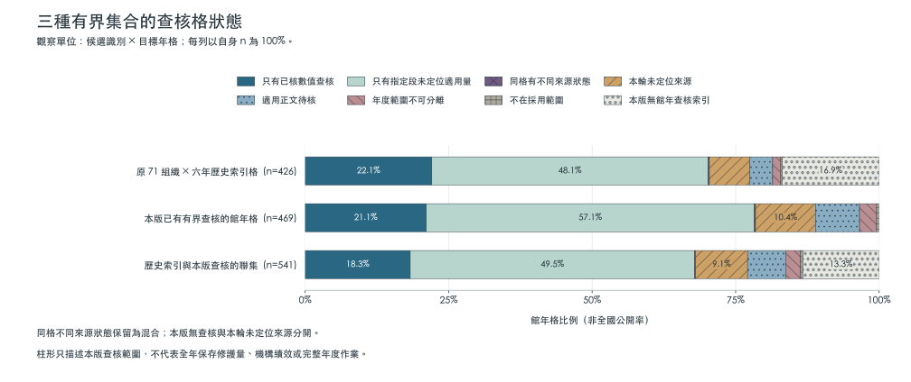
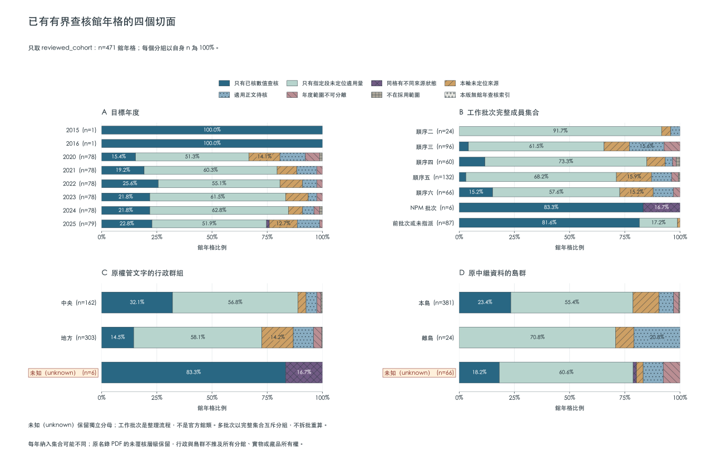

# 查核格的範圍與覆蓋分母

版本v0.15.0。觀察單位是候選識別×目標年格，不是修護物件或完整報告份數。

三個集合分開呈現；狀態保留全部目前來源，混合狀態不以最高層級覆蓋。

|集合|館年格數|目前來源查核則數|本版無查核格|至少一來源有已核紀錄的格|
|---|---:|---:|---:|---:|
|原71組織×2020–2025歷史索引格|426|365|72|95|
|本版已有有界查核的館所候選×目標年|469|480|0|100|
|原歷史索引與本版有界查核的聯集|541|480|72|100|

原426格與實際review格不同；無查核不能改為本輪未定位來源。聯集也不是98個候選的所有年份或全國母體。
已有數值仍只證明所列來源分項，不代表完整年度量；不提供全國公開率或績效排名。

## 分組的意思

working_category_by_batch只表示原NPM／順序二至六工作文件實列的流程成員，不是官方館類。未在這些表中指派者保留pre_batch_or_unassigned；不推未曾研究。多批次以完整成員集合形成互斥組，沒有一格重算多次。
admin_group只分原權管／營運文字中可辨識的中央、地方或unknown，不代表藏品所有權、法律登記或營運形式。island_group只分原名錄或權管行政區的島群；多場址或資料不足保持unknown，不推實物與所有分館位置。原名錄PDF未核的層級保留。
各年納入集合可能不同，不能看柱形差異便推斷作業或機構行為趨勢。
JSON與CSV提供各集合按工作批次成員集合×行政群組×島群×年交叉的實際分母及狀態數；0格不是0件。

[完整coverage.json](../metadata/coverage.json) · [逐格CSV](../data/coverage_cells.csv) · [分組CSV](../data/coverage_groups.csv) · [分組原始證據](../metadata/organization_dimensions.json)

